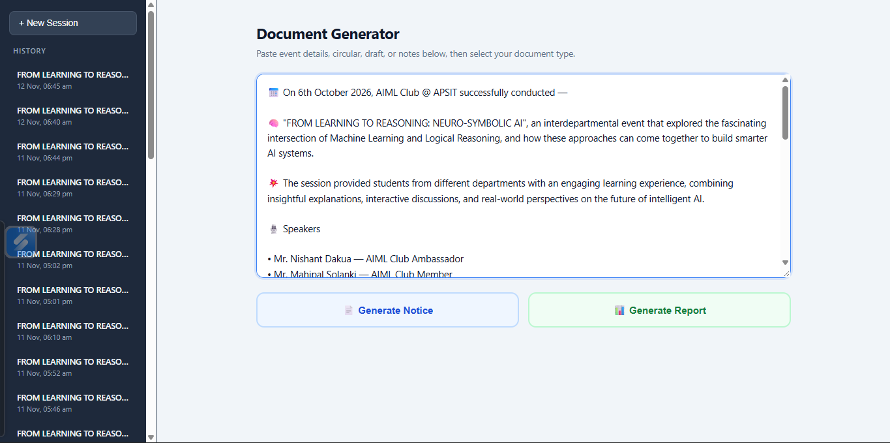
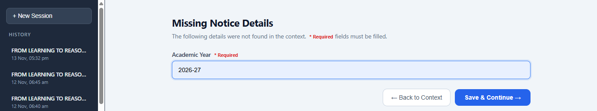
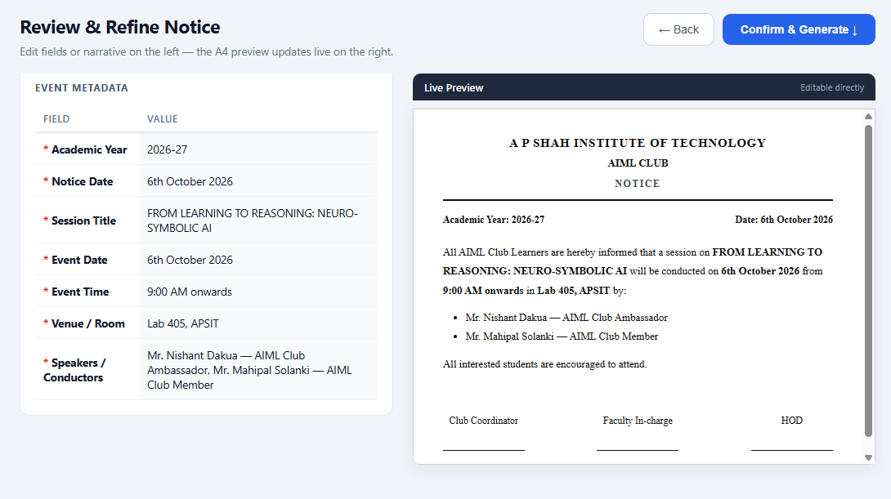
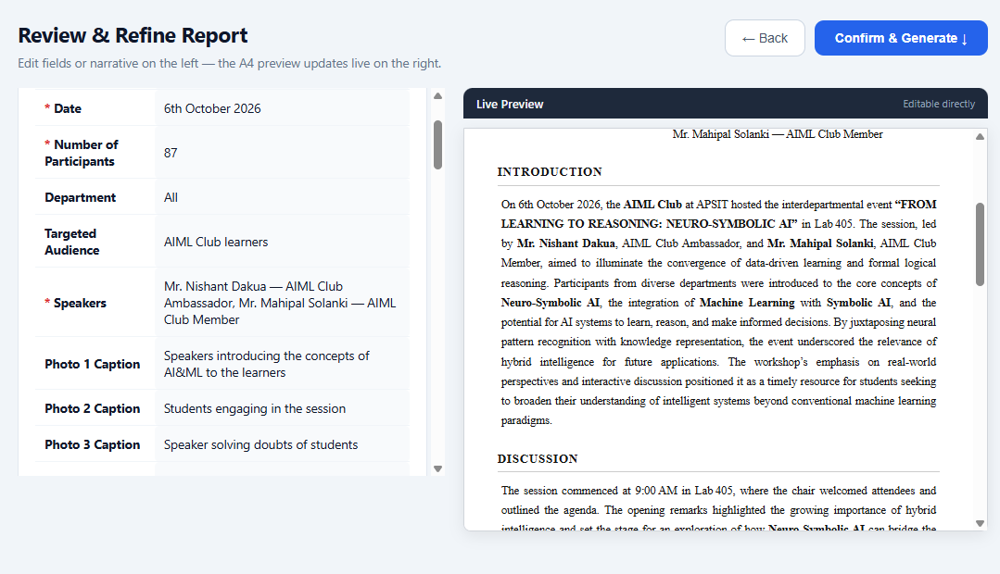
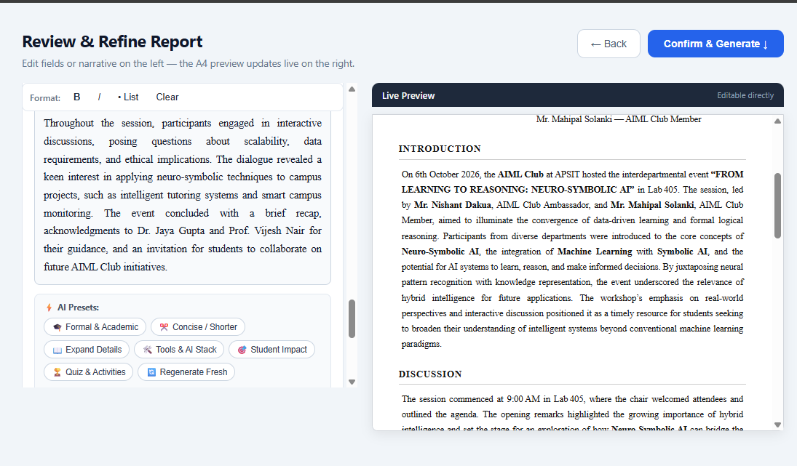
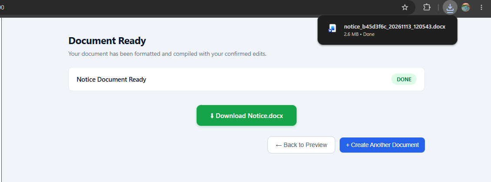
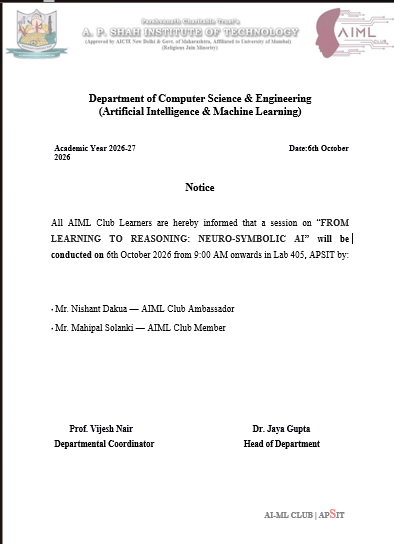
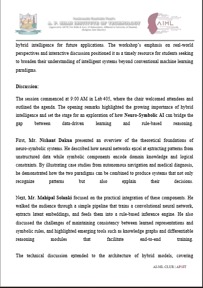
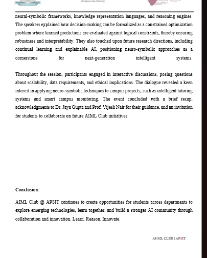

# Report & Notice Document Generator

An automated pipeline that converts raw event notes into formatted, style-preserved `.docx` documents (**Notice** & **Report**) using **Groq LLM** and **docxtpl**, with direct offline downloads.

---

## ⚡ Quick Setup Guide

### 1. Install Dependencies

Open your terminal in the project root directory and run:

```bash
pip install -r backend/requirements.txt
```

---

### 2. Configure Environment (`.env`)

Create a `.env` file in the project root (you can copy `.env.example`):

```env
# Groq API Configuration (Get your key from https://console.groq.com/keys)
LLM_API_KEY=gsk_your_groq_api_key_here
LLM_MODEL=llama-3.3-70b-versatile
LLM_BASE_URL=https://api.groq.com/openai/v1

# Storage Paths
DB_PATH=./app.db
OUTPUT_DIR=./output
TEMPLATES_DIR=./templates
```

---

### 3. Start the Server

Run the FastAPI backend with:

```bash
python -m uvicorn app.main:app --reload --app-dir backend
```

---

### 4. Open the Application

Navigate to **[http://127.0.0.1:8000](http://127.0.0.1:8000)** in your browser.

### 5. Outputs

Adding the Context Text for Notice & Report Generation



Adding Missing required felids 



Preview Of Output with added details Of Notice and Report





Using Preset U can also Update text in the report



Generated Output Notice





## 🚀 How to Use

```
Paste Context ──► Select Template ──► Verify / Fill Missing ──► Download .docx
```

1. **Paste Text**: Paste raw context or event notes into the main text box.
2. **Select Template**: Click **📄 Notice Template** or **📊 Report Template**.
3. **Missing Fields**: If any required detail is not found in the context, a quick form prompts you to enter it.
4. **Preview & Edit**: Review all extracted fields in an inline table; click any cell to edit.
5. **Download**: Click **Generate** to get the filled `.docx` file with all header logos, formatting, and photos intact.

---


## 📁 Project Directory

```
Report Generator/
├── README.md                 # Setup and usage guide (this file)
├── .env                      # Your private API keys (gitignored)
├── .env.example              # Example environment configuration
├── backend/                  # FastAPI backend
│   ├── app/
│   │   ├── api/routes/       # API endpoints (sessions, fields, generate, download)
│   │   ├── core/             # Pipeline stages (extractor, validator, formatter, filler)
│   │   ├── db/               # SQLite connection and SQLAlchemy models
│   │   ├── llm/              # Groq API client and extraction prompts
│   │   └── main.py           # Application entry point
│   └── requirements.txt      # Python dependencies
├── frontend/                 # ChatGPT-style web interface
│   ├── index.html            # Single-page wizard
│   ├── style.css             # Dark sidebar & clean canvas styles
│   └── app.js                # Frontend logic and API calls
├── templates/                # Word templates and field specifications
│   ├── notice/               # Notice template.docx & fields.json
│   └── report/               # Report template.docx & fields.json
├── documents/                # Design specifications and architecture docs
└── output/                   # Generated .docx files (gitignored)
```
